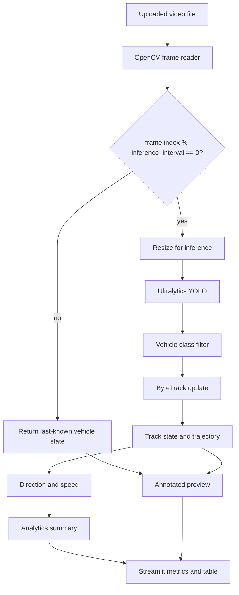

# TrafficVision AI

**A modular computer-vision prototype for vehicle detection, multi-object tracking, trajectory analysis, and traffic-oriented summaries from video.**

TrafficVision AI converts traffic video into per-vehicle observations using an Ultralytics YOLO detector and ByteTrack (via `supervision`). It keeps per-track state and trajectories, estimates image-plane direction and displacement-based speed, and summarises the run.

> **Research status:** this is an implementation prototype, not a validated traffic measurement system. The repository contains no labelled evaluation data and no benchmark results. All outputs are model-derived estimates. Speed values are only physical (km/h) when the camera is calibrated, and even then they are not perspective-corrected.

## Contents

- [Problem and motivation](#problem-and-motivation)
- [Capabilities and status](#capabilities-and-status)
- [Architecture](#architecture)
- [Methodology](#methodology)
- [Configuration](#configuration)
- [Repository structure](#repository-structure)
- [Technology stack](#technology-stack)
- [Setup and execution](#setup-and-execution)
- [Testing and validation](#testing-and-validation)
- [Evaluation methodology](#evaluation-methodology)
- [Limitations](#limitations)
- [Research directions](#research-directions)
- [Troubleshooting](#troubleshooting)
- [References](#references)
- [License](#license)

## Problem and motivation

Traffic video contains spatial and temporal information, but turning it into vehicle-level observations requires detection and association across frames. Partial occlusion, small or distant vehicles, lighting changes, motion blur, perspective, and identity switches all degrade this. The repository includes no labelled dataset, so it does not establish robustness to any of these conditions.

## Capabilities and status

Status labels: **Implemented** (code path exercised by the Streamlit app or tests), **Partial** (code exists but has a stated gap), **Reserved** (config key only, no effect), **Not included**.

| Capability | Approach | Location | Status |
|---|---|---|---|
| Vehicle detection | Ultralytics YOLO, COCO classes 2/3/5/7 | `app/detection/detector.py` | Implemented; accuracy not measured |
| Inference scheduling | Detector and tracker run every `inference_interval` frames | `app/pipeline.py` | Implemented; skipped frames reuse last-known state |
| Multi-object tracking | `supervision.ByteTrack` with persistent track IDs | `app/tracking/tracker.py` | Implemented; tracking quality not measured |
| Lost-track handling | Tracks not matched in an update are marked `lost`; they are kept but not drawn | `app/tracking/tracker.py`, `app/utils/drawing.py` | Implemented |
| Class voting | Majority vote over per-frame class labels | `app/tracking/tracker.py` | Implemented |
| Trajectory history | Bounded deque of `(x, y, t)` centre points at inference frames | `app/tracking/tracker.py` | Implemented |
| Direction | Eight image-plane directions from start/end of trajectory window | `app/utils/trajectory.py` | Implemented; not geographic bearings |
| Speed | Displacement between last two inference samples, moving-average smoothed | `app/speed/estimator.py` | Partial: uncalibrated values are px/s; calibrated values have no perspective correction |
| Speed calibration | One `pixels_per_meter`, or two image points plus a real distance | `app/config/settings.py` | Implemented; global scale only |
| Traffic summary | Track totals, active count, class/direction counts, mean speed of active tracks | `app/analytics/analytics.py` | Partial: totals count retained tracks, not line crossings |
| Vehicle counting | Virtual counting line | — | Not included |
| Local-video UI | Upload, bounded processing, annotated preview, active-track table | `streamlit_app.py` | Implemented; end-to-end run with real video and YOLO weights not verified here |
| Webcam and URL input | `FileVideoSource`, `WebcamVideoSource`, `URLVideoSource` | `app/video/source.py` | Partial: module exists and is not used by the UI |
| Exported annotated video | — | — | Not included |
| Ground-truth metrics (mAP, HOTA, IDF1, counting error) | — | — | Not included |
| Perspective-aware calibration | Camera or road-plane homography | — | Not included |

## Architecture



Only inference frames touch the detector and tracker. Skipped frames return the state from the most recent inference frame, so boxes and trajectories refresh at the inference rate.

Module responsibilities:

- `app/pipeline.py`: `FrameProcessor`, the per-frame orchestration (scheduling, detection, tracking, direction, speed).
- `app/detection/detector.py`: YOLO wrapper and result parsing.
- `app/tracking/tracker.py`: ByteTrack adapter and persistent `TrackedVehicle` state.
- `app/speed/estimator.py`: speed estimates and calibration helper.
- `app/utils/trajectory.py`: direction and path length.
- `app/analytics/analytics.py`: run-level summary.
- `app/utils/drawing.py`: boxes, labels, trajectories (active tracks only by default).
- `app/config/settings.py`: typed configuration and YAML loader.
- `app/video/source.py`: source abstractions (not used by the current UI).
- `streamlit_app.py`: the only user-facing entry point.

## Methodology

### Detection and inference scheduling

The detector runs on frames whose index is a multiple of `detection.inference_interval` (default 2). Each inference frame is resized so its width is at most `detection.processing_width` (default 640). The returned boxes are rescaled to the original frame size. The detector passes confidence, IoU, class IDs, and device to the Ultralytics predict API. NMS is handled by the library; the repository does not implement its own.

Skipped frames do not call the detector and do not update the tracker. Earlier versions re-fed the previous boxes to ByteTrack on skipped frames with new timestamps. That produced duplicate trajectory points, zero-displacement speed samples, and inflated frame counts, so it was removed.

### Tracking

`VehicleTracker` passes each inference frame's detections to `supervision.ByteTrack` and keeps per-track state keyed by the returned track ID. Each track records the last box, a majority-vote class label, first and last seen timestamps, a count of inference updates (`frames_seen`), and a bounded trajectory.

Track IDs are temporary. ByteTrack can reassign identities after long occlusions, and IDs are not comparable across separate runs. Tracks not matched in an update get `status = "lost"`. They stay in the run's track list but are not drawn and do not contribute to active-track speed statistics.

`tracking.lost_track_buffer` and `tracking.frame_rate` are passed to ByteTrack. Because ByteTrack only sees inference frames, `lost_track_buffer` counts inference updates, not video frames. `frame_rate` is a fixed config value; it is not derived from the video's FPS.

### Trajectory and direction

Each trajectory point is `(x, y, timestamp_s)`: the box centre in original-frame pixels and the video timestamp (frame index / FPS). Direction is the compass label closest to the angle of the displacement from the first to the last point of the window. If that displacement is under 8 px, the label is `Stationary`. Image y increases downward, so the labels are image-plane directions, not compass bearings.

### Speed and calibration

For the last two trajectory points `(x1, y1, t1)` and `(x2, y2, t2)` with `t2 > t1`:

`v_px/s = sqrt((x2-x1)^2 + (y2-y1)^2) / (t2-t1)`

Each sample is averaged with up to `speed.smoothing_window - 1` previous samples for the same track (default window 5). When a scale is available:

`v_km/h = (v_px/s / pixels_per_meter) * 3.6`

The scale comes from `speed.pixels_per_meter`, or from `speed.calibration_points` (two image points) and `speed.calibration_real_distance_m`. An explicit `pixels_per_meter` takes priority. Calibrated values are clamped to `speed.max_plausible_kmh`.

Without a scale, the value is in px/s and labelled `px/s~` on the frame and `px/s (approx.)` in the table. It is not a real-world speed. A single global scale ignores perspective: the same pixel displacement represents different real distances at different image positions. Speed is computed from video timestamps, not wall-clock time. Setting `speed.enabled: false` disables it.

### Counting and traffic summary

The summary (`TrafficAnalytics`) reports:

- **Tracks retained**: all tracks in the run, including lost ones. This is not a count of unique vehicles and not a count of line crossings.
- **Active at last processed frame**: tracks with `status == "active"` after the final inference frame.
- **Mean speed of active tracks**: the average of their current smoothed speeds, labelled with its unit. Lost tracks are excluded.
- **Class and direction distributions**: counts over all retained tracks.
- **Flow per minute** (computed but not shown in the UI): retained tracks divided by elapsed video minutes since the first track. It is a coarse statistic.

No counting line exists, so the repository does not measure vehicles crossing a point. Treat the summary as a descriptive aid.

## Configuration

Defaults live in `configs/default.yaml`. The loader maps sections to dataclasses in `app/config/settings.py`. Missing files fall back to the same defaults. Unknown keys are ignored silently, so check spelling. The Streamlit sidebar edits only the frame limit and the config path.

Keys that take effect:

| Section | Keys |
|---|---|
| `detection` | `model_name`, `confidence_threshold`, `iou_threshold`, `processing_width`, `inference_interval`, `classes`, `device` |
| `tracking` | `track_activation_threshold`, `lost_track_buffer`, `minimum_matching_threshold`, `frame_rate`, `minimum_consecutive_frames`, `trajectory_length` |
| `speed` | `enabled`, `pixels_per_meter`, `calibration_points`, `calibration_real_distance_m`, `smoothing_window`, `max_plausible_kmh` |
| `ui` | `show_labels`, `show_trajectories` |

Reserved keys, parsed but not used by the code yet: `processing_mode` (presets are defined in `get_processing_mode_presets()` but never applied), `detection.frame_skip`, `ui.ui_update_interval`, `ui.max_table_rows`, `ui.theme_accent`, and the whole `demo` section.

Example calibration (two image points on a lane marking 3.5 m apart):

```yaml
speed:
  calibration_points: [[120, 400], [520, 400]]
  calibration_real_distance_m: 3.5
```

## Repository structure

```text
trafficvision-ai/
├── .streamlit/config.toml
├── LICENSE                 # MIT, Muhammad Zulqarnain Abdullah (2026)
├── README.md
├── AUDIT.md                # verification status of earlier audit items
├── requirements.txt
├── packages.txt
├── streamlit_app.py
├── configs/
│   ├── default.yaml
│   └── demo_videos.yaml
├── tests/
│   ├── test_app_smoke.py
│   ├── test_pipeline_tracking.py
│   └── test_trajectory_speed.py
└── app/
    ├── pipeline.py
    ├── analytics/analytics.py
    ├── config/settings.py
    ├── detection/detector.py
    ├── speed/estimator.py
    ├── tracking/tracker.py
    ├── utils/drawing.py
    ├── utils/trajectory.py
    └── video/source.py
```

`configs/demo_videos.yaml` is not read by any code in this repository.

## Technology stack

| Technology | Role |
|---|---|
| Python 3 | Application code |
| Ultralytics | YOLO inference |
| supervision (≥0.23, <0.24) | ByteTrack association |
| OpenCV | Video decoding, resize, drawing |
| NumPy | Arrays |
| Streamlit | Upload and preview UI |
| PyYAML | Configuration |
| Requests | Used only by `URLVideoSource` |
| PyTorch / Torchvision | Ultralytics runtime |
| pytest | Tests |

Dependency ranges are in `requirements.txt`. There is no lockfile and no tested platform matrix.

## Setup and execution

Prerequisites: Git and a Python version with wheels for PyTorch, Ultralytics, and OpenCV on your platform.

```bash
git clone https://github.com/Mzaq1559/trafficvision-ai.git
cd trafficvision-ai
python -m venv .venv
# Linux/macOS
source .venv/bin/activate
# Windows PowerShell: .\.venv\Scripts\Activate.ps1
python -m pip install --upgrade pip
python -m pip install -r requirements.txt
```

Run the UI from the repository root:

```bash
streamlit run streamlit_app.py
```

Upload a video (mp4, avi, mov, or mkv) and click **Process video**. The app processes at most the configured number of frames, shows the annotated preview, and then shows throughput, the summary, and a table of active tracks. It does not write an annotated video file. Throughput includes decoding, inference, tracking, and preview rendering.

The first inference downloads `yolov8n.pt` through Ultralytics unless a copy is available locally. If PyTorch fails to install, use the [PyTorch installation selector](https://pytorch.org/get-started/locally/).

Check the configuration without starting inference:

```bash
python -c "from app.config import load_config; print(load_config())"
```

## Testing and validation

```bash
python -m pytest -q
```

The suite has 16 tests:

- `tests/test_trajectory_speed.py` (10): direction classes, trajectory length, calibration math, speed units, timestamp guard, config defaults, missing and invalid config, two-point calibration derivation.
- `tests/test_pipeline_tracking.py` (5): inference scheduling (detector called only on inference frames; tracker sees 3 updates for 6 frames), speed from inference timestamps, `speed.enabled`, lost tracks retained but not drawn, and analytics speed statistics that exclude lost tracks.
- `tests/test_app_smoke.py` (1): the Streamlit script renders its initial state without exceptions (uses `streamlit.testing`).

The pipeline tests use a scripted fake detector, so they run without YOLO weights or PyTorch. They do not measure detection accuracy, tracking quality, or real-video behaviour. The test suite does not exercise the processing loop in `streamlit_app.py` on a real video.

Lint and types (run on the branch): `ruff check app streamlit_app.py tests` and `mypy app --ignore-missing-imports`.

## Evaluation methodology

No benchmark results are included. A scientifically meaningful evaluation should record model weights and version, Python and dependency versions, hardware and device, input resolution, FPS, and duration, inference settings (including `inference_interval`), the number of runs, warm-up, and whether decoding, tracking, annotation, and output are included in timing.

Recommended metrics, each needing its own ground truth:

- Detection: precision, recall, and mAP against labelled boxes.
- Tracking: HOTA or IDF1 against annotated tracks.
- Counting: count error against manually verified counts, once a counting line exists.
- Speed: error against surveyed distances or reference speeds, per calibration and per image region.
- Throughput: FPS as throughput only, with the measurement scope stated.

## Limitations

- Occlusion, small or distant vehicles, lighting, blur, and domain shift can cause missed detections.
- Tracks can fragment and switch identity. `tracking.frame_rate` is a constant, not the video FPS.
- Between inference frames, the UI shows the last inference boxes. Speed and direction change only at inference frames.
- Speed is an approximation from two samples, smoothed over a short window. Uncalibrated values are not physical speeds. Calibrated values have no perspective correction.
- Direction labels are image-relative.
- Totals and flow are not line-crossing counts.
- Lost tracks are kept for the whole run, so memory grows with the number of tracks. Long runs have not been tested.
- The UI processes at most `max_frames` frames (30–600) and does not export video.
- Reserved config keys have no effect.
- OpenCV codec support depends on the installed build.
- Dependencies are not locked. Cross-platform reproducibility has not been established.
- No labelled evaluation or validated deployment is included.

Do not use outputs for enforcement or safety-critical decisions without independent validation.

## Research directions

1. Evaluate detection on labelled traffic data and compare model variants.
2. Evaluate tracking on annotated sequences with appropriate MOT metrics.
3. Add a virtual counting line and compare its counts with manual counts.
4. Calibrate the camera or road plane and validate speed against reference measurements.
5. Measure accuracy and throughput across resolution and inference-interval settings.
6. Test across camera angles, weather, lighting, and traffic density.
7. Measure CPU memory and throughput for edge deployment.

## Troubleshooting

- **Missing weights:** check internet access, or place a locally available, appropriately licensed `yolov8n.pt` in the working directory and set `detection.model_name` to its path.
- **Video cannot open:** check the path and codec; try an MP4 (H.264) that your OpenCV build supports.
- **Slow CPU inference:** lower `processing_width` or raise `inference_interval`, then re-check tracking quality.
- **Streamlit launch fails:** activate the virtual environment, reinstall requirements, and run from the repository root.
- **Config has no effect:** check key spelling (unknown keys are ignored) and whether the key is reserved.
- **`supervision` error on startup:** confirm `pip show supervision` reports 0.23.x. Older versions reject the `minimum_consecutive_frames` argument.
- **Webcam unavailable:** the UI does not offer webcam input; `WebcamVideoSource` is not wired in.

## References

- Ultralytics YOLO documentation: https://docs.ultralytics.com/
- Zhang et al., "ByteTrack: Multi-Object Tracking by Associating Every Detection Box," ECCV 2022: https://arxiv.org/abs/2110.06864
- Supervision documentation: https://supervision.roboflow.com/
- OpenCV documentation: https://docs.opencv.org/
- Streamlit documentation: https://docs.streamlit.io/
- PyTorch documentation: https://pytorch.org/docs/stable/index.html

This project uses these libraries. It does not reproduce a published system or introduce a new detector or tracker.

## License

The source code is licensed under the MIT License; see [LICENSE](LICENSE) (copyright 2026 Muhammad Zulqarnain Abdullah). Pretrained weights (for example Ultralytics YOLO checkpoints), third-party dependencies, and any sample videos are governed by their own terms and are not relicensed by this repository. Verify those terms before redistribution.
