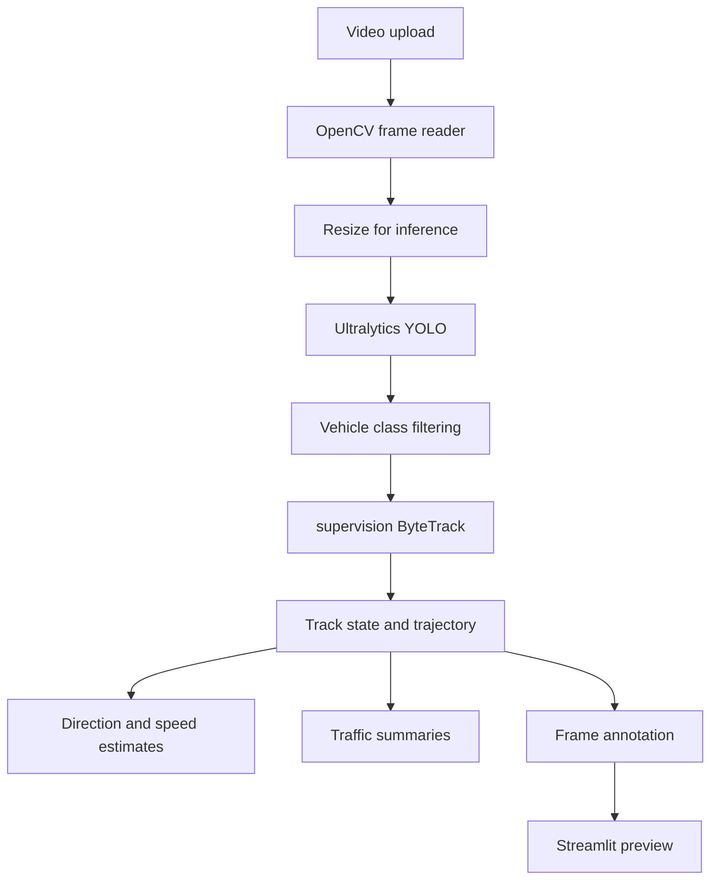

# TrafficVision AI

**A modular computer-vision prototype for vehicle detection, multi-object tracking, trajectory analysis, and traffic-oriented summaries from video.**

TrafficVision AI explores converting traffic video into structured vehicle observations using an Ultralytics YOLO detector and ByteTrack via `supervision`. It maintains per-track state and trajectories, derives image-plane direction, estimates displacement-based speed, and aggregates summary statistics.

> **Research status:** the repository provides an implementation prototype, not a validated traffic measurement system. It does not currently include labelled evaluation data or benchmark results. Reported outputs must be treated as model-derived estimates.

## Contents

- [Problem and motivation](#problem-and-motivation)
- [Capabilities](#capabilities)
- [Architecture](#architecture)
- [Methodology](#methodology)
- [Repository structure](#repository-structure)
- [Technology stack](#technology-stack)
- [Setup and execution](#setup-and-execution)
- [Testing and evaluation](#testing-and-evaluation)
- [Limitations](#limitations)
- [Research directions](#research-directions)
- [Troubleshooting](#troubleshooting)
- [References](#references)
- [License](#license)

## Problem and motivation

Traffic video contains spatial and temporal information, but converting it into useful vehicle-level observations requires detection and association across frames. General challenges include partial occlusion, small/distant vehicles, changing illumination, motion blur, perspective effects, and identity switches. The repository does not include a labelled evaluation dataset, so it does not establish robustness to any specific challenge.

## Capabilities

| Capability | Technical approach | Implementation | Status |
|---|---|---|---|
| Vehicle detection | Ultralytics YOLO inference | `app/detection/detector.py` | Implemented; accuracy not benchmarked |
| Vehicle class filtering | COCO IDs 2, 3, 5, 7: car, motorcycle, bus, truck | `app/detection/detector.py`, `configs/default.yaml` | Implemented |
| Multi-object tracking | `supervision.ByteTrack` | `app/tracking/tracker.py` | Implemented; tracking quality not evaluated |
| Trajectory history | Bounded history of center points and video timestamps | `app/tracking/tracker.py` | Implemented |
| Image-plane direction | Eight-direction displacement classification | `app/utils/trajectory.py` | Implemented; not geographic bearings |
| Speed estimate | Pixel displacement/time, optional pixels-per-meter conversion | `app/speed/estimator.py` | Implemented; real-world accuracy unvalidated |
| Traffic summaries | Track/class/direction counts, average speed, flow estimate, processing FPS | `app/analytics/analytics.py` | Implemented; semantics are approximate |
| Local-video UI | Streamlit upload, bounded processing, annotated frame preview | `streamlit_app.py` | Entry point provided; runtime still needs local validation |
| Ground-truth metrics | mAP, HOTA, IDF1, counting error | — | Not included |
| Perspective-aware calibration | Camera/road-plane calibration | — | Not included |

## Architecture



- `app/video/source.py`: OpenCV-backed file, webcam, and URL source abstractions.
- `app/detection/detector.py`: YOLO loading and detection parsing.
- `app/tracking/tracker.py`: ByteTrack adapter, track IDs, class voting, trajectory state.
- `app/pipeline.py`: per-frame orchestration.
- `app/speed/estimator.py`: displacement-based speed estimates and calibration conversion.
- `app/utils/trajectory.py`: direction and pixel path length.
- `app/analytics/analytics.py`: aggregate summaries.
- `app/utils/drawing.py`: bounding boxes, labels, and trajectory polylines.
- `app/config/settings.py`: typed configuration dataclasses and YAML loader.
- `configs/default.yaml`: default settings.
- `streamlit_app.py`: upload and preview interface.

## Methodology

### Detection

The default model is `yolov8n.pt`. The detector passes confidence, IoU, class IDs, and device to the Ultralytics prediction API. Model post-processing, including NMS, is handled by the library; the repository does not implement a separate NMS algorithm. Model weights are not committed and may be downloaded on first use.

### Tracking

The tracker uses `supervision.ByteTrack` for association and maintains vehicle state keyed by track ID. It records class votes and a bounded history of bounding-box centers. Track IDs are temporary identities, not guaranteed persistent identities for physical vehicles across long occlusions or separate videos.

### Trajectory and direction

Each point is `(x, y, timestamp_s)`, with center coordinates in image pixels. Direction is estimated from displacement over the trajectory window. Since image y-coordinates increase downward, labels such as “North” and “East” are image-plane directions, not compass bearings.

### Speed and calibration

For points ((x_1,y_1,t_1)) and ((x_2,y_2,t_2)), pixel speed is:

`v_px/s = sqrt((x2-x1)^2 + (y2-y1)^2) / (t2-t1)`

When a positive pixels-per-meter scale is configured directly—or derived from two configured reference points and their known real-world distance:

`v_km/h = (v_px/s / pixels_per_meter) * 3.6`

Without calibration, the result is px/s and must not be interpreted as real-world speed. A global scale does not correct perspective: the same pixel displacement can represent different real distances at different image locations. Physical speed estimates require calibration and validation against known distances or reference speeds.

### Counting and traffic flow

The aggregator's retained track count is not equivalent to unique vehicles crossing a counting line. Its flow-per-minute statistic is based on retained tracks and elapsed video time, not explicit line-crossing events. Treat it as a coarse summary until a counting-line implementation is validated against manually verified counts.

## Repository structure

```text
trafficvision-ai/
├── .streamlit/config.toml
├── LICENSE
├── README.md
├── AUDIT.md
├── requirements.txt
├── packages.txt
├── streamlit_app.py
├── configs/
│   ├── default.yaml
│   └── demo_videos.yaml
├── tests/
│   └── test_trajectory_speed.py
└── app/
    ├── pipeline.py
    ├── analytics/analytics.py
    ├── config/settings.py
    ├── detection/detector.py
    ├── speed/estimator.py
    ├── tracking/tracker.py
    ├── utils/drawing.py
    ├── utils/trajectory.py
    └── video/source.py
```

## Technology stack

| Technology | Role |
|---|---|
| Python | Application and processing code |
| Ultralytics | YOLO model inference |
| Supervision / ByteTrack | Multi-object association |
| OpenCV | Video capture, resize, and drawing |
| NumPy | Detection arrays and numerical operations |
| Streamlit | Local upload and preview UI |
| PyYAML | Configuration loading |
| Requests | Downloading public URL videos |
| PyTorch / Torchvision | Model runtime |
| pytest | Lightweight unit tests |

Dependency ranges are declared in `requirements.txt`; there is no exact lockfile or verified platform matrix.

## Setup and execution

Prerequisites: Git and a Python version compatible with the dependency wheels for your platform.

```bash
git clone https://github.com/Mzaq1559/trafficvision-ai.git
cd trafficvision-ai
python -m venv .venv
# Linux/macOS
source .venv/bin/activate
# Windows PowerShell: .\.venv\Scripts\Activate.ps1
python -m pip install --upgrade pip
python -m pip install -r requirements.txt
```

Launch the UI from the repository root:

```bash
streamlit run streamlit_app.py
```

Upload a video and click **Process video**. The UI limits processing to a configurable number of frames and displays the current annotated frame plus track information. It does not export a full annotated video. Webcam availability depends on the host machine and is generally not available in hosted containers.

The default model is `yolov8n.pt`. Ultralytics may download it on first inference; offline use requires a locally available weight file. If PyTorch installation fails, use the official [PyTorch installation selector](https://pytorch.org/get-started/locally/) to select compatible wheels.

Load configuration without starting inference:

```bash
python -c "from app.config import load_config; print(load_config())"
```

Main defaults live in `configs/default.yaml`: confidence, IoU, processing width, inference interval, classes, tracking parameters, and optional speed calibration.

## Testing and evaluation

Run the lightweight synthetic suite:

```bash
python -m pytest -q
```

Tests cover trajectory calculations, speed conversion, and configuration validation. They do not download weights or evaluate YOLO accuracy, ByteTrack quality, or end-to-end UI behavior. Run them in a clean environment before relying on the project.

No labelled dataset or measured benchmark is included. A reproducible evaluation should record model version/weights, Python and dependency versions, hardware/device, input resolution/FPS/duration, inference settings, number of runs, warm-up procedure, and whether decoding, tracking, annotation, and output writing are included. Use ground truth for precision/recall/mAP, annotated tracks for suitable MOT metrics (e.g. HOTA or IDF1), and verified counts for counting error. Processing FPS is throughput, not accuracy.

## Limitations

- Occlusion, small/distant vehicles, lighting, blur, and domain shift may cause missed detections.
- Tracking can produce fragmented tracks and identity switches.
- Direction labels are image-relative, not geographic.
- Global pixels-per-meter conversion does not correct perspective.
- Retained track totals and flow estimates are not line-crossing counts.
- Reusing detections between inference frames may produce stale boxes.
- OpenCV codec support depends on the installed build.
- Dependencies are not exactly locked and cross-platform reproducibility is not established.
- No labelled evaluation or validated deployment is included.

Do not use outputs for enforcement or safety-critical decisions without independent validation.

## Research directions

1. Evaluate detection on labelled traffic datasets and compare model variants.
2. Evaluate tracking with annotated sequences and appropriate MOT metrics.
3. Add virtual counting lines and compare counts with manually verified references.
4. Calibrate the camera/road plane and validate speed against reference measurements.
5. Measure accuracy-throughput trade-offs across resolution and inference intervals.
6. Evaluate different camera angles, weather, lighting, and traffic densities.
7. Measure CPU memory and throughput for possible edge deployment.

## Troubleshooting

- **Missing weights:** check internet access or supply a locally available, appropriately licensed model file.
- **Video cannot open:** verify the path and codec; try an MP4 supported by your OpenCV build.
- **Slow CPU inference:** reduce processing width or increase inference interval, then evaluate tracking impact.
- **Streamlit launch fails:** activate the virtual environment, install dependencies, and run from the repository root.
- **Invalid configuration:** ensure YAML is a mapping and confidence/IoU values are between 0 and 1.
- **Webcam unavailable:** use a local uploaded video; hosted services generally cannot access your physical camera.

## References

- Ultralytics YOLO documentation: https://docs.ultralytics.com/
- Zhang et al., “ByteTrack: Multi-Object Tracking by Associating Every Detection Box,” ECCV 2022: https://arxiv.org/abs/2110.06864
- Supervision documentation: https://supervision.roboflow.com/
- OpenCV documentation: https://docs.opencv.org/
- PyTorch documentation: https://pytorch.org/docs/stable/index.html

The project uses these libraries; it does not claim to reproduce an entire paper or introduce a novel detector/tracker.

## License

The repository includes an MIT license attributed to Muhammad Zulqarnain Abdullah. Pretrained weights, dependencies, and sample videos may have separate terms; verify them before redistribution.
